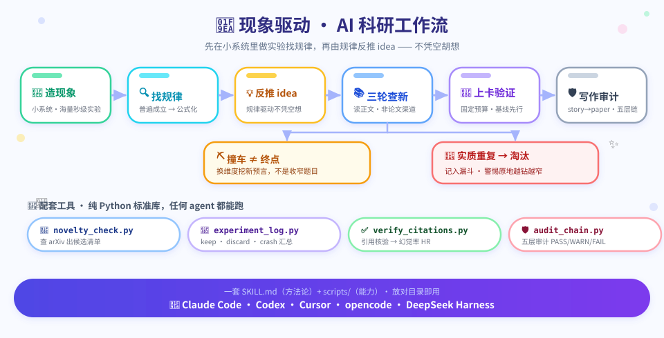

<div align="center">

# AI Research Workflow

**先做实验找规律，再反推 idea —— 不凭空胡想。**

一套跨平台的科研工作流 skill：`SKILL.md` 方法论 + 8 个零依赖脚本，装在 Claude Code / Codex / Cursor / opencode / DeepSeek Harness 上都能用。

[](LICENSE)
[](../../releases)
[](https://github.com/zhuowenzhang288-web/ai-research-workflow/stargazers)
[](https://github.com/zhuowenzhang288-web/ai-research-workflow/commits)



</div>

---

## 为什么需要它

让 agent 做科研，卡点通常不在"会不会写代码"，而在四个习惯：

- **凭空想 idea** —— 张口就是听过八百遍的方向，查新一过就死
- **只读摘要就下判定** —— 扫一眼 abstract 说"没人做过"，正文里早写满了
- **题目越做越窄** —— 方向死了就钻更细的变体，每窄一级重付一轮查新和实验
- **把猜想写成结论** —— 没有实验支撑，投稿时全露馅

这套工作流用**硬纪律 + 可执行工具**把这四条堵住。它的规则不是想出来的：是在一个单卡 ICML 选题项目里，26 次挖空位、30 个现象全部失败之后总结的。

## 它怎么工作

核心是把顺序反过来。传统流程是「先想 idea → 查新 → 做实验」；agent 凭空想 idea 的能力弱，这里改成：

1. **第 0 步：立项确认** —— 先和用户对齐方向、目标会议、算力、预算、距截稿几周、什么算成功，写进 `PROJECT_BRIEF.md`。约束没对齐，后面每步都在猜。
2. **造现象** —— 在一个能精确测量的小系统（0.1–4M 参数）里跑几百个秒级实验，找异常和规律。开工前先看**已发表论文怎么做实验**，拿它们的系统规模、旋钮、指标当模板，而不是随机盲扫。
3. **找规律** —— 每批实验后追问"有没有一条简单规律在所有条件下都成立"，剔除不稳定的，把站得住的写成公式。
4. **反推 idea** —— 规律 → 解释 → 选题。文献挖空位是次选，凭空想是最后手段。
5. **三轮查新** —— 相同问题 / 相同方法 / 相邻领域；判"新/旧"必须读正文的方法、实验、图表，**只读摘要不得下 KEEP/KILL**。
6. **上卡验证** —— 固定预算、基线先行、评测只读，每次实验记 keep/discard/crash。
7. **五层审计** —— 实验诚实性、结论-证据一致、论文如实性、引用、最强反驳；任一层不过不出终稿。

查新撞车不等于全灭：换一个文献没测过的观测维度，可能翻出新的可证伪预言。

## 8 个工具

全部纯 Python 标准库，没有任何第三方依赖。任何能跑 `bash` 的 agent 都能直接调用。

| 工具 | 环节 | 用法 |
|---|---|---|
| `project_brief.py` | 第 0 步立项 | `init` 交互填写 → `PROJECT_BRIEF.md`；`check` 查算力/时间与子领域的硬约束冲突 |
| `venue_probe.py` | 造现象前 | `python3 scripts/venue_probe.py "关键词"` 找已发表论文的实验设计当模板（`--venue` 可过滤会议） |
| `novelty_check.py` | 查新 | `python3 scripts/novelty_check.py "关键词"` 查 arXiv 出候选清单 |
| `novelty_report.py` | 查新取证 | 校验报告里每篇引用的「读取程度」标注，缺标即 FAIL |
| `funnel.py` | 选题漏斗 | `add` / `list`；`narrow-watch` 检出"同一方向反复做窄变体" |
| `experiment_log.py` | 实验日志 | `add` 记一次 / `list` 汇总 keep·discard·crash |
| `verify_citations.py` | 引用核验 | 核验 arXiv/DOI 是否存在，输出幻觉率 HR |
| `audit_chain.py` | 审计链 | 五层逐层判定；`verify-results` 查报告里的数值能否在日志中找到锚点 |

## 快速开始

```bash
git clone https://github.com/zhuowenzhang288-web/ai-research-workflow
cd ai-research-workflow
./install.sh          # 自动检测本机 agent 平台并装好
```

`install.sh` 会找到已支持的平台（Claude Code / Codex / Cursor / DSH / AGENTS）并拷贝 `SKILL.md` + `scripts/`。也可手动：

| 平台 | 安装 |
|---|---|
| Claude Code | `mkdir -p ~/.claude/skills/ai-research-workflow && cp -r SKILL.md scripts ~/.claude/skills/ai-research-workflow/` |
| Codex | `mkdir -p ~/.codex/skills/ai-research-workflow && cp -r SKILL.md scripts ~/.codex/skills/ai-research-workflow/` |
| Cursor | `mkdir -p .cursor/skills/ai-research-workflow && cp -r SKILL.md scripts .cursor/skills/ai-research-workflow/` |
| opencode | `opencode.json` 里 `"instructions": ["/path/to/SKILL.md"]` |
| DeepSeek Harness | `mkdir -p ~/.dsh/skills/ai-research-workflow && cp -r SKILL.md scripts ~/.dsh/skills/ai-research-workflow/`，或装 [dsh-research-agent](https://github.com/zhuowenzhang288-web/dsh-research-agent) |

装好后 agent 会在遇到科研任务时按需加载。想让它**一定在场**，把 `AGENTS.md` 放到项目根目录——多数 harness 每次请求自动注入。

## 双保险

普通 skill 的通病是靠 agent 自觉加载，一忙就忘。所以这里分两层：

| 层 | 内容 | 加载方式 |
|---|---|---|
| `AGENTS.md` | 核心纪律精简版 | 每次请求自动注入，不漏 |
| `SKILL.md` | 完整方法论 + 实战教训 | 按需加载，补全细节 |

## 它从哪来

规则来自一个真实项目：单卡、9 周、想做 ICML 主会。

- 检索型挖空位 **26 个方向 0 存活** → 才改成现象驱动
- 一天内两个方向被"找到空白"骗了 → 才写下"空白 ≠ 值得补"
- 两个评测 bug 白烧 40+ 次 GPU → 才定下"管道先验证再解释数据"
- 一个方向连钻 5 个窄变体全死 → 才定下"窄 ≠ 安全，换方向优于钻缝"

这些都整理进了 `SKILL.md` 的实战教训一节，每条标注落实在哪个章节。

## 目录

```
SKILL.md                  方法论本体
AGENTS.md                 核心纪律精简版（自动注入）
AUTO_MODE.md              用 goal + schedule 拼自动循环
scripts/                  8 个零依赖工具
docs/architecture.svg     架构图（由 gen_architecture.py 生成，勿手改）
install.sh                一键安装
sync.sh                   三处副本一致性检查（--check 可进 CI）
```

## DSH 深度集成版

想要"选一个模式就是科研 agent"——人格与纪律常驻、不用等加载——用 [dsh-research-agent](https://github.com/zhuowenzhang288-web/dsh-research-agent)。

## 贡献

欢迎 issue 和 PR。最有价值的贡献是**实战教训**：你用这套流程踩了坑、发现某条规则不对或不够，比改代码更珍贵。见 [CONTRIBUTING.md](CONTRIBUTING.md)。

## License

MIT
