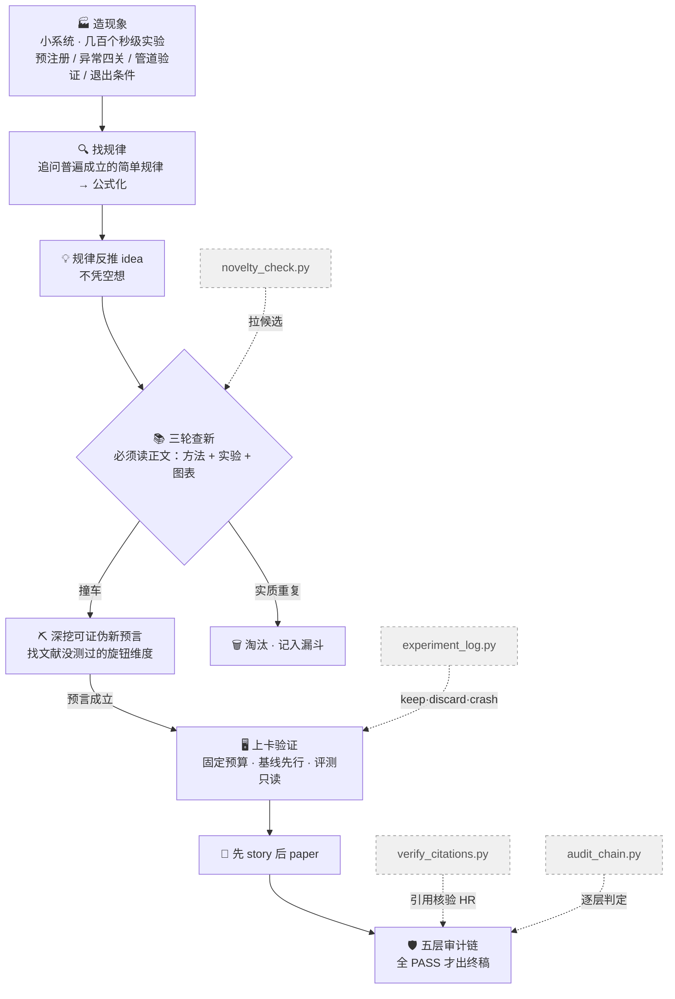

# 让 AI Agent 真的会做科研：现象驱动研究工作流

> **先做实验找规律，再反推 idea。不凭空胡想。**

一套跨平台、带可执行工具的科研工作流 skill——把「AI agent 想 idea 很不靠谱」这个毛病，用**现象驱动**和**真能跑的脚本**治住。

---

## 你的 AI 是不是也这样？

| 痛点 | 表现 |
|---|---|
| 凭空胡想 idea | 张口就是几个听过八百遍的方向，查新一过就死 |
| 只读摘要就下结论 | 扫一眼 abstract 就说"这个没人做过"，其实正文里早写满了 |
| 把猜想当结论 | "我认为""应该可以"，没有实验支撑，写成论文全露馅 |
| 引用凭印象编 | 编号、作者、数字随手写，一核准是错的 |

这些不是 AI 不够聪明，是**没有一套硬纪律 + 可执行工具**在压着它。

---

## 我们换了个思路：现象驱动

传统科研 workflow 是「先想 idea → 查新 → 做实验」。但 **agent 凭空想 idea 的能力很弱**——真实项目里连开 24 个方向，0 个存活。

**反过来**就通了——idea 是挖出来的，不是憋出来的：



在能精确测量的小系统里跑几百个秒级实验，让规律自己浮出来。虚线框是 4 个配套脚本，各挂在它服务的环节上。

---

## 不是又一份"提示词"，是能直接跑的脚本

纯文档谁都会写，这套带 **4 个零依赖脚本**（只靠 Python 标准库，任何 agent 跑 `bash` 就能用）：

| 脚本 | 干什么 | 一句话用法 |
|---|---|---|
| `novelty_check.py` | 查新 | `python3 scripts/novelty_check.py "GRPO collapse"` → 直接列出 arXiv 候选 |
| `experiment_log.py` | 实验日志 | `add` 记一次 / `list` 汇总 keep·discard·crash |
| `verify_citations.py` | 引用核验 | 一键核验报告里的 arXiv/DOI，输出幻觉率 HR |
| `audit_chain.py` | 投稿审计 | 五层审计链，汇总 PASS/WARN/FAIL |

---

## 30 秒开始用

```bash
git clone https://github.com/zhuowenzhang288-web/ai-research-workflow
cd ai-research-workflow
```

然后复制到你的 agent 平台（下面任选一个）：

| 平台 | 命令 |
|---|---|
| **Claude Code** | `mkdir -p ~/.claude/skills/ai-research-workflow && cp -r SKILL.md scripts ~/.claude/skills/ai-research-workflow/` |
| **Codex** | `mkdir -p ~/.codex/skills/ai-research-workflow && cp -r SKILL.md scripts ~/.codex/skills/ai-research-workflow/` |
| **Cursor** | `mkdir -p .cursor/skills/ai-research-workflow && cp -r SKILL.md scripts .cursor/skills/ai-research-workflow/` |
| **opencode** | 在 `opencode.json` 里 `"instructions": ["/path/to/SKILL.md"]` |
| **DeepSeek Harness** | `mkdir -p ~/.dsh/skills/ai-research-workflow && cp -r SKILL.md scripts ~/.dsh/skills/ai-research-workflow/`（或装 [bundle](https://github.com/zhuowenzhang288-web/dsh-ai-research-workflow)） |

> 核心就是 `SKILL.md` + `scripts/` 两份东西，放对目录就能用，不绑定任何框架。

---

## 它从真实项目里长出来，不是纸上谈兵

这套方法的每一个规则，都是在一个**单卡 ICML 选题项目**里用真金白银换来的：

- **检索型挖空位 24 方向 0 存活** → 才悟出"现象驱动"
- **一天内两个方向被"空白"骗了** → 才写下"找到空白≠值得补"
- **两个评测 bug 白烧 40+ 次 GPU** → 才定下"管道先验证"

这些教训已整理成 6 条「实战教训」写进 SKILL.md，每条都标了现身章节。

---

## 目录

```
SKILL.md                  # 完整方法论（384 行 + 6 条实战教训）
scripts/
├── novelty_check.py      # 查新
├── experiment_log.py     # 实验日志
├── verify_citations.py   # 引用核验
└── audit_chain.py        # 五层审计
README.md
LICENSE
```

## License

MIT